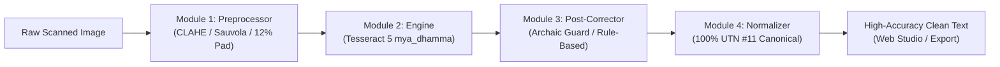

# မြန်မာခေတ်ဟောင်း ခဲစာလုံး ပုံနှိပ်စာအုပ်များ OCR စနစ်နှင့် Training နည်းစနစ် လက်စွဲကျမ်း
## (Myanmar Dhamma & Old Books Lead-Type OCR: Comprehensive System & Training Manual)

**ပရောဂျက်:** `uzinbymuse/ocrfor-mmoldbooksbyzin`  
**ရည်မှန်းချက်:** ၁၉ ရာစု/၂၀ ရာစု ခေတ်ဟောင်း ခဲစာလုံးပုံနှိပ် မူရင်းဓမ္မစာအုပ်ကြီးများ (သပြေကန်ဆရာတော်ကြီး၏ တရားစာအုပ်များ၊ ကစ္စာယနသဒ္ဒါကျမ်း၊ မေဒိနီ၊ ရူပသိဒ္ဓိ စသည်) မှ ပါဠိ/မြန်မာစာသားများကို တိကျမှု ၉၈%–၉၉%+ အထိ တိကျမှန်ကန်စွာ ထုတ်ယူဖတ်ရှုနိုင်သော OCR စနစ် တည်ဆောက်ခြင်း။  
**နောက်ဆုံး အဆင့်မြှင့်တင်သည့်ရက်စွဲ:** ၂၀၂၆ ခုနှစ်၊ နိုဝင်ဘာလ ၂၄ ရက်။

---

## မာတိကာ (Table of Contents)
1. [စနစ်ဗိသုကာ (System Architecture)](#၁-စနစ်ဗိသုကာ-system-architecture)
2. [Data Engineering နှင့် Ground Truth ပြင်ဆင်နည်း](#၂-data-engineering-နှင့်-ground-truth-ပြင်ဆင်နည်း)
3. [Tesseract 5 LSTM Fine-Tuning နည်းပညာစနစ်](#၃-tesseract-5-lstm-fine-tuning-နည်းပညာစနစ်)
4. [Frozen Benchmark နှင့် Automated Golden-Set Regression Gate](#၄-frozen-benchmark-နှင့်-automated-golden-set-regression-gate)
5. [မော်ဒယ်များ၏ သမိုင်းဝင် တိုးတက်မှု မှတ်တမ်း (v1 မှ v13_real အထိ)](#၅-မော်ဒယ်များ၏-သမိုင်းဝင်-တိုးတက်မှု-မှတ်တမ်း)
6. [ရရှိခဲ့သော အရေးကြီး သင်ခန်းစာများနှင့် အကောင်းဆုံး လေ့ကျင့်နည်းများ](#၆-ရရှိခဲ့သော-အရေးကြီး-သင်ခန်းစာများ)

---

## ၁။ စနစ်ဗိသုကာ (System Architecture)

OCR စနစ်တစ်ခုလုံးကို အဆင့် ၄ ဆင့်ပါ **Unified Drop-in Pipeline (`core/ocr_pipeline.py`)** ဖြင့် တည်ဆောက်ထားပါသည် —



### (က) Module 1: ပုံရိပ်ကြိုတင်သန့်စင်ခြင်း (Image Preprocessor - `core/image_preprocessor.py`)
ခဲစာလုံးစာအုပ်ဟောင်းများသည် စာရွက်ဝါခြင်း၊ မင်စွန်းခြင်း၊ ကျောဘက်စာသား ဖောက်ထွင်းမြင်ရခြင်း (Ghost bleed-through) နှင့် စာလုံးအစွန်းများ ပျံ့နှံ့ခြင်း (Ink spread) စသည့် ပြဿနာများ ရှိပါသည်။
* **Sauvola / Niblack Local Adaptive Thresholding:** တစ်မျက်နှာလုံး အလင်းအမှောင်မညီမှုကို ပြေလည်စေရန် ကွက်တိ Local Window ဖြင့် Binarization ပြုလုပ်သည်။
* **CLAHE (Contrast Limited Adaptive Histogram Equalization):** မှိန်နေသော စာလုံးများကို အလင်းအမှောင် ကွာခြားချက် မြှင့်တင်ပေးသည်။
* **12% Vertical Padding Rule:** မြန်မာစာတွင် အပေါ်တင်ဗျည်း/သရများ (`ိ ီ ံ င်္`) နှင့် အောက်ဆင့်ဗျည်းများ (`္ဓ ္ပ ္ဌ`) သည် Bounding Box အစွန်းတွင် ကပ်ညှပ်ခံရတတ်သဖြင့် လိုင်းပုံရိပ်တိုင်း၏ အထက်/အောက်တွင် **အနည်းဆုံး ၁၂% စာရွက်ဖြူ နေရာလွတ် (Vertical Padding)** မဖြစ်မနေ ထည့်သွင်းပေးရသည်။

### (ခ) Module 2: စာဖတ်အင်ဂျင် (OCR Engine - `core/ocr_engine.py`)
* Google Tesseract 5.x ၏ LSTM Neural Network ကို အခြေခံသည်။
* ဓမ္မစာပေသီးသန့် လေ့ကျင့်ထားသော `tessdata/mya_dhamma_*.traineddata` မော်ဒယ်များကို အသုံးပြုသည်။
* Line-level OCR အတွက် `--psm 7` (Single Line) သို့မဟုတ် Full Page အတွက် `--psm 6` (Uniform block of text) ကို သုံးသည်။

### (ဂ) Module 3: စာလုံးပေါင်း အမှားပြင်ခြင်း (Post-Corrector - `core/post_corrector.py`)
* **Archaic Spelling Protection:** ခေတ်ဟောင်း မူရင်းသတ်ပုံများဖြစ်သော `တရုပ်` (ယနေ့ `တရုတ်`)၊ `သဘောက်` (ယနေ့ `သဘော`)၊ `ခပင်း`၊ `အပြဉ်း` စသည်တို့ကို ခေတ်သစ်စာလုံးပေါင်းများဖြင့် အတင်းအဓမ္မ မပြင်မိစေရန် Guardrail ထားရှိသည်။
* **Rule-Based Dhamma Proofreader:** `ပ္ပ` vs `ပွ` (အတ္ထုပ္ပတ္တိ)၊ `၇/၈/၉` vs `ဂ/စ/မ` ရောထွေးမှုများကို စာလုံးအဆက်အစပ် (N-gram) ဖြင့် အမှားပြင်ဆင်သည်။
* **Confidence-Gated Review:** ပျမ်းမျှ Confidence ၈၀% အောက် ကျဆင်းသော စာကြောင်းများကို Web Studio QC သို့ အလိုအလျောက် ပေးပို့စစ်ဆေးစေသည်။

### (ဃ) Module 4: ယူနီကုဒ်စံသတ်မှတ်ခြင်း (Canonical Normalizer - `core/myanmar_normalizer.py`)
* **Unicode Technical Note #11 (UTN #11) စံ ၁၀၀% လိုက်နာခြင်း:**
  * အက္ခရာအစဉ်: `ဗျည်း + (အသတ် + အောက်မြစ်) + (အသတ် + အခြားသင်္ကေတများ)`
  * မူလ Subagent အမှားဖြစ်ခဲ့သော `\u1037\u103a` (အောက်မြစ် + အသတ်) ကို တရားဝင်စံဖြစ်သော `\u103a\u1037` (အသတ် + အောက်မြစ်) သို့ အလိုအလျောက် အစဉ်အတိုင်း ညှိနှိုင်းပေးသည်။
  * Kinzi (`င်္`), Visual E-vowel (`ေ`), Tall-Aa (`ါ`) တို့ကို စနစ်တကျ Canonical Form သို့ ပြောင်းလဲပေးသည်။

---

## ၂။ Data Engineering နှင့် Ground Truth ပြင်ဆင်နည်း

ခေတ်ဟောင်းပုံနှိပ်စာများအတွက် Machine Learning Training တွင် **"Garbage In, Garbage Out"** မဖြစ်စေရန် Data ပြင်ဆင်မှုသည် မော်ဒယ်တည်ဆောက်မှု၏ အသက်တမျှ အရေးကြီးပါသည်။

### (က) Ground Truth ဒေတာအုပ်စုများ (Batches 1 to 7)
1. **Batches 1–5 (သပြေကန် အတွဲ ၁ နှင့် ၂):** လူသားစစ်ဆေးပြီး စာကြောင်းရေ ၃၅၆ ကြောင်း (အမှားလုံးဝကင်းစင်သော 100% Verified GT)။
2. **Batch 6 Multi-Book Grammar Pack:** ကစ္စာယနသဒ္ဒါကျမ်း၊ မေဒိနီကျမ်း၊ ရူပသိဒ္ဓိကျမ်း စသည့် သဒ္ဒါကျမ်းကြီးများမှ စာကြောင်းရေ ၅၈ ကြောင်း (ပါဠိစာလုံးဆင့်များနှင့် သဒ္ဒါဝေါဟာရများ)။
3. **Batch 7 Surgical Micro-Pack:** ခဲစာလုံးဖောင့်တွင် အခက်ခဲဆုံးဖြစ်သော `ဉာဏ်`, `ပ္ပ`, `ဋ္ဌ`, `ဏ္ဍ` စာလုံးများပါဝင်သည့် ခဲစာလုံးစာကြောင်း ၃၄ ကြောင်း။

### (ခ) Oversampling နည်းစနစ် (Scarce Real Data Amplification)
ခဲစာလုံးစာအုပ်စစ်စစ်မှ ညှပ်ယူထားသော Real Ground Truth စာကြောင်းရေသည် နည်းပါးပါသည် (စုစုပေါင်း ၄၀၈ ကြောင်းခန့်သာရှိသည်)။
* အကယ်၍ စာကြောင်းရေ ၄၀၈ ကြောင်းကို တစ်ကြိမ်တည်း လေ့ကျင့်ပါက LSTM သည် အလွယ်တကူ Overfit ဖြစ်ပြီး ပျက်ပြယ်သွားနိုင်သည်။
* ထို့ကြောင့် Real Ground Truth များကို **၃ ကြိမ်မှ ၅ ကြိမ် (3× to 5× oversample)** ထပ်ခါတလဲလဲ ထည့်သွင်းပေးခြင်းဖြင့် စာကြောင်းရေ **၁,၂၀၀ မှ ၂,၀၄၀ လိုင်း** အထိ အလေးသာစေကာ Batching ကို တည်ငြိမ်စေခဲ့သည်။

### (ဂ) Synthetic Data အသုံးပြုခြင်းဆိုင်ရာ အရေးကြီး စည်းမျဉ်းများ (Dos and Don'ts)
* **ဘယ်အချိန်မှာ သုံးမလဲ (When to Use):**  
  မူရင်း Google Tesseract unicharset တွင် လုံးဝမပါဝင်ခဲ့သော ရှားပါးစာလုံး ၁၀ လုံး (`ဣ ဩ ဪ ၏ ၌ ၍ ။ ၊ ဈ ဎ`) နှင့် မြန်မာဂဏန်းများ (`၀–၉`) အတွက် စတင်မိတ်ဆက်ပေးချိန် (Initial Warmup Phase) တွင် အလွန် အသုံးဝင်သည်။
* **ဘယ်အချိန်မှာ မသုံးရဘူးလဲ (When NOT to Use - Critical Lesson):**  
  မော်ဒယ်သည် အခြေခံကျက်မှတ်ပြီးသည့်နောက် ခဲစာလုံးဖောင့်အစစ်ကို လေ့ကျင့်ရာတွင် **Synthetic Lines အရေအတွက်သည် စုစုပေါင်းဒေတာ၏ ၁၅% ထက် မကျော်လွန်စေရ**။ ကွန်ပျူတာဖောင့်များသည် ခဲစာလုံး၏ မင်ပျံ့နှံ့မှုစရိုက် (Lead-type physical noise) မရှိသဖြင့် Synthetic များလွန်းပါက မော်ဒယ်သည် ကွန်ပျူတာဖောင့်ဘက်သို့ ယိမ်းယိုင်သွားပြီး (Font Drift) မူရင်းစာအုပ်အစစ်များတွင် တိကျမှု သိသိသာသာ ပြုတ်ကျသွားစေသည်။
* **Punctuation Balance Rule:**  
  ပါဠိစာကြောင်းများသည် ပုဒ်မ `။` ဖြင့် အဆုံးသတ်လေ့ရှိသဖြင့် Synthetic ဒေတာတွင် ပုဒ်ကလေး `၊` နှင့် ပုဒ်မ `။` အချိုးကို **အနည်းဆုံး ၁:၁ သို့မဟုတ် ပုဒ်ကလေး ၂ : ပုဒ်မ ၁ အချိုး** ဖြင့် တမင်ထိန်းညှိ ထည့်သွင်းပေးရသည်။ မဟုတ်ပါက မော်ဒယ်သည် ပုဒ်ကလေး `၊` မြင်သမျှကို ပုဒ်မ `။` အဖြစ် မှားယွင်း ခန့်မှန်းသွားတတ်သည်။

---

## ၃။ Tesseract 5 LSTM Fine-Tuning နည်းပညာစနစ်

### (က) အဘယ်ကြောင့် `tesstrain` tool ကို မသုံးဘဲ Direct `lstmtraining` ကို သုံးရသနည်း။
Tesseract အသိုင်းအဝိုင်းတွင် လူသုံးများသော `tesstrain.py` သို့မဟုတ် `tesstrain.sh` wrapper များသည် မြန်မာစာအတွက် virama (`\u1039`) အောက်ဆင့်ဗျည်း box များကို WordStr အဖြစ် ဖွဲ့စည်းရာတွင် အောက်ဆင့်များကို ဖျက်ပစ်ခြင်း သို့မဟုတ် အစီအစဉ်မှားယွင်းခြင်းစသည့် virama bug ရှိပါသည်။  
ကျွန်တော်တို့စနစ်သည် **`WordStr` format အစစ်ဖြင့် Box ဖိုင်များကို ကိုယ်တိုင်တည်ဆောက်ပြီး Tesseract 5 ၏ `lstmtraining` ကို တိုက်ရိုက်ခေါ်ယူသည်** ဖြစ်ရာ virama bug အန္တရာယ်မှ ၁၀၀% ကင်းလွတ်ပါသည်။

### (ခ) Replace Top Layer Fine-Tuning စနစ်
* **Unicharset တိုးချဲ့ခြင်း:**  
  မူရင်း Google `mya.traineddata` (148 classes) မှ ဓမ္မစာပေသုံး ၁၅၉/၁၆၂ classes အထိ `unicharset_extractor` နှင့် `merge_unicharsets` ဖြင့် တိုးချဲ့သည်။
* **Net Spec သတ်မှတ်ချက်:**  
  `--append_index 5 --net_spec "[Lfx192 O1c${NUM_CLASSES}]"`  
  ဤနည်းသည် LSTM ၏ အောက်ခြေ Image Feature Extractor အလွှာ ၄ လွှာကို မူလအတိုင်း ထိန်းသိမ်းထားပြီး ထိပ်ဆုံး Softmax Output အလွှာကိုသာ အသစ်လဲလှယ်ကာ လေ့ကျင့်ပေးသဖြင့် လေ့ကျင့်ချိန် အလွန်မြန်ဆန်ပြီး မူလအခြေခံ အသိဉာဏ် မပျက်စီးစေပါ။

### (ဂ) Learning Rate နှင့် Schedule နည်းဗျူဟာ
1. **Initial Fine-Tune (Top-layer replacement):**  
   `learning_rate = 0.0004` သို့မဟုတ် `0.0003` (၃,၅၀၀ မှ ၄,၅၀၀ iterations)။
2. **Balanced Fine-Tune (Multi-Book Expansion):**  
   `learning_rate = 0.0002` (၁,၅၀၀ မှ ၂,၀၀၀ iterations)။
3. **Surgical Ultra-Short Polish (Zero-Catastrophic Forgetting):**  
   `learning_rate = 0.00005` (၁၅၀ မှ ၃၀၀ iterations သာ)။  
   *မှတ်ချက် — အဆင့်မြင့်ပြီးသော မော်ဒယ်ကို ထပ်မံ Polish လုပ်ရာတွင် iteration ၂၀၀–၃၀၀ ထက် ကျော်လွန်ပါက အကောင်းဆုံးနေရာမှ ပြန်လည်ယိုယွင်းသွားတတ်သည် (Over-adaptation)*။

---

## ၄။ Frozen Benchmark နှင့် Automated Golden-Set Regression Gate

မော်ဒယ်အသစ်တစ်ခုကို လေ့ကျင့်ပြီးတိုင်း "ကောင်းမကောင်း" ဆုံးဖြတ်ရန် Training Loss သို့မဟုတ် Training BCER တစ်ခုတည်းကို ကြည့်၍ မရပါ။ (ဥပမာ- `v11` တွင် Training BCER သည် 2.15% အထိ ကျဆင်းသော်လည်း ပြင်ပစာအုပ်အစစ်များတွင် တိကျမှု ကျဆင်းသွားခဲ့သည်)။

ထို့ကြောင့် မည်သည့်အခါမျှ Training Data ထဲ မထည့်သွင်းသော **Frozen Benchmark စာမျက်နှာ ၄ မျက်နှာ** ဖြင့် တင်းကျပ်စွာ စစ်ဆေးသည် —

| Benchmark စာမျက်နှာ | အကဲဖြတ်သည့် အဓိက စရိုက်လက္ခဏာ | Target Threshold |
| :--- | :--- | :---: |
| **၁။ Basic Kaccāyana Grammar p.5** (၁,၂၃၀ လုံး) | သဒ္ဒါကျမ်း ခဲစာလုံးဖောင့် အစစ် (`ဉာဏ်`, `သဒ္ဒါ`, `သင်္ဂြိုဟ်`, `ဝိနည်း`) | Raw $\ge 94.80\%$ |
| **၂။ Unseen Vol 2 p.23** (၁,၇၇၉ လုံး) | သပြေကန်အတွဲ ၂ ခဲစာလုံး၊ ရှားပါးစာလုံး `ဣ` နှင့် ပုဒ်ကလေး `၊` recall | $\ge 97.50\%$, `၊` $\ge 49/54$ |
| **၃။ Unseen Vol 1 p.17 (`သူလိုရဟန်း`)** (၁,၂၀၄ လုံး) | သပြေကန်အတွဲ ၁ စာလုံးဆင့် `ပ္ပ` (၁၂/၁၂) နှင့် ရှားပါးစာလုံး `၏, ၌, ၍` | $\ge 96.80\%$, `ပ္ပ` 100% |
| **၄။ Vol 1 Preface p.11** (၂၁ လိုင်း, ၁,၀၈၃ လုံး) | စာမျက်နှာဟောင်း မင်မှိန်ခြင်းနှင့် အစွန်းဖျက်ဆီးခံရမှု အခြေအနေ | $\ge 92.80\%$ |

### Automated Regression Gate (`scripts/eval_golden.py`)
`scripts/train_mya_dhamma_*.sh` script တိုင်းသည် Export မလုပ်မီ `eval_golden.py` ကို ခေါ်ယူ၍ `reports/baseline_v10.json` နှင့် အလိုအလျောက် နှိုင်းယှဉ်စစ်ဆေးသည်။  
အကယ်၍ မော်ဒယ်သစ်၏ CER သည် Baseline ထက် **0.20 percentage points** ထက် ကျဆင်းခဲ့လျှင် မော်ဒယ်ကို **အလိုအလျောက် Reject လုပ်ပြီး Production သို့ Release မလုပ်ဘဲ တားမြစ်သည်**။

---

## ၅။ မော်ဒယ်များ၏ သမိုင်းဝင် တိုးတက်မှု မှတ်တမ်း

```
[Google Base mya.lstm] (Missing 10 rare glyphs, 148 classes)
       │
       ▼
[mya_dhamma_v2] (159 classes, 844 lines, BCER 2.736%)
       │
       ▼
[mya_dhamma_v8_clean] (Clean-Slate, 356 Human lines, 96.51% on Unseen p.23)
       │
       ▼
[mya_dhamma_v9_balanced] (828 lines, 98.20% historic record on Unseen p.23, ပ္ပ 100%)
       │
       ▼
[mya_dhamma_v10] (766 lines, Multi-Book Grammar Pack, 95.50% 4-Page Mean) ───► [ACTIVE PRODUCTION]
       │
       ├──► [mya_dhamma_v11] (6,800 lines with Subagent Unicode bug) ───► [REJECTED / HOLD]
       │
       ├──► [mya_dhamma_v12] (2,724 lines, 100% UTN #11 repaired) ───► [HOLD: Kaccayana -2.60%]
       │
       ├──► [mya_dhamma_v12b] (85% Real, 14.6% Synth, best @100 iters) ───► [HOLD: Kaccayana 94.15%]
       │
       └──► [mya_dhamma_v13_real] (100% Real Crops, 0% Synthetic, 150-300 iters) ───► [CURRENT RUN]
```

### အသေးစိတ် မော်ဒယ်နှိုင်းယှဉ်ချက် ဇယားကြီး

| မော်ဒယ်အမည် | အဓိက အင်္ဂါရပ်နှင့် ဒေတာဖွဲ့စည်းပုံ | Vol 2 p.23 | Kaccāyana p.5 | ရှားပါးစာလုံး | အဆင့်အတန်း |
| :--- | :--- | :---: | :---: | :---: | :---: |
| **`mya.traineddata` (Google)** | မူရင်း မော်ဒယ်ဟောင်း (Missing 10 chars) | ~88.0% | <80.0% | 0% (Missing) | Obsolete |
| **`v8_clean`** | Human Batches 1–5 (356 lines) | 96.51% | — | `ဣ` 9/9 | Superseded |
| **`v9_balanced`** | Option B balanced lines (828 entries) | **98.20%** | 88.37% | `ပ္ပ` 12/12 | Superseded |
| **`v10` (Current)** | Multi-Book Grammar Pack (766 entries) | **97.58%** | **94.80%** (Post: 97.7%) | စုံလင် | **ACTIVE PRODUCTION** |
| **`v11`** | Beatson + Synthetic (6,800 entries) | 96.80% | 92.11% | `၊` ပြိုကျ | REJECTED (HOLD) |
| **`v12`** | 100% UTN #11 (2,724 entries) | 97.75% | 92.68% | `၊` 49/54 | REJECTED (HOLD) |
| **`v12b`** | 85% Real + 14.6% Synth (2,390 entries) | **97.86%** | **94.15%** (Post: 96.1%) | CER 7.13% | HOLD (Best @100) |
| **`v13_real`** | 100% Real Lead-Type (0% Synth, 150–300 iters) | *(In Progress)* | *(Target $\ge 95\%$)* | *(Target 100%)* | Training Script Ready |

---

## ၆။ ရရှိခဲ့သော အရေးကြီး သင်ခန်းစာများ (Key Engineering Insights)

1. **Synthetic Data ၏ ကန့်သတ်ချက် (The Synthetic Ceiling):**
   ကွန်ပျူတာဖောင့်ဖြင့် ပြုလုပ်ထားသော Synthetic data သည် ရှားပါးစာလုံး စတင်မိတ်ဆက်ရန်အတွက် ကောင်းမွန်သော်လည်း၊ ခဲစာလုံးစာအုပ်အစစ်များတွင် မော်ဒယ်၏ အဆုံးသတ်တိကျမှုကို ဆုံးဖြတ်ပေးသည်မှာ **တကယ့် စာအုပ်မှ ညှပ်ယူထားသော Real Scanned Crops သာလျှင် အဓိက ဖြစ်သည်**။
2. **Ultra-Short Polish သည် Overfitting ကို ကာကွယ်နိုင်ခြင်း:**
   ကောင်းမွန်ခိုင်မာပြီးသား အခြေခံမော်ဒယ် (`v10`) အား ဆက်လက်လေ့ကျင့်ရာတွင် iteration ထောင်နှင့်ချီ မလေ့ကျင့်သင့်ပါ။ Step ၁၅၀ မှ ၃၀၀ အတွင်းတွင် အကောင်းဆုံး အမှတ်ကို ရရှိလေ့ရှိပြီး၊ Step ၅၀၀ ကျော်လွန်ပါက မူလသိရှိပြီးသား စာလုံးများကို မေ့လျော့ခြင်း (Catastrophic Forgetting) သို့မဟုတ် ကောက်ယူမှုလွဲချော်ခြင်း (Drift) ဖြစ်ပေါ်တတ်သည်။
3. **Regression Gate မရှိဘဲ မော်ဒယ်အသစ် မထုတ်သင့်ခြင်း:**
   Training Loss ကျဆင်းသွားရုံဖြင့် မော်ဒယ်ကောင်းသည်ဟု မယူဆနိုင်ပါ။ Held-out Benchmark စာမျက်နှာများဖြင့် အမှားလုံးရေကို တိုက်ရိုက် ရေတွက်စစ်ဆေးသော Regression Gate ရှိမှသာ မော်ဒယ်အရည်အသွေးကို စဉ်ဆက်မပြတ် အာမခံနိုင်မည် ဖြစ်ပါသည်။
4. **Human-in-the-Loop (HITL) Web Studio ၏ အကျိုးသက်ရောက်မှု:**
   သံသယရှိသော စာကြောင်းများကို ပညာရှင်ကိုယ်တိုင် Web UI (`/qc`) ပေါ်တွင် Bounding box ဖြင့် ချက်ချင်းကြည့်ရှုပြင်ဆင်ပြီး Ground Truth crop အသစ်များအဖြစ် စက္ကန့်ပိုင်းအတွင်း ပြန်လည်ထုတ်ယူနိုင်ခြင်းသည် စနစ်၏ တိကျမှုကို ရေရှည်တွင် ၉၉%+ သို့ တင်ပေးနိုင်သော အကောင်းဆုံး မောင်းနှင်အား ဖြစ်ပါသည်။

---
*မှတ်တမ်းတင်သူ: Lead AI Verifier & QA Agent*  
*အတည်ပြုသူ: ဆရာတော် / ဦးဇင်း (uzinbymuse)*
